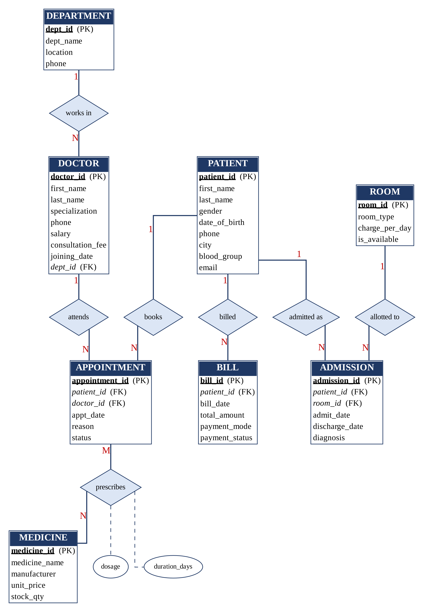

# MediCare Hospital Management System

A healthcare database project built with **MySQL 8.0** for the Database Management System (DBMS) subject.
It stores departments, doctors, patients, appointments, room admissions, medicines, prescriptions and bills for a fictional hospital.

**University:** Chandigarh University, University Institute of Engineering (B.E. CSE, Semester 3)

## Team 3

| Name | UID |
|---|---|
| Ishika Pandey | 25BCS11688 |
| Bhavya Baid | 25BCS10268 |
| Arjita Shrivastava | 25BCS12986 |

## Database tables (9)

`department`, `doctor`, `patient`, `appointment`, `room`, `admission`, `medicine`, `prescription`, `bill`



## What the project covers

- ER diagram and relational schema
- Normalization up to 3NF
- DDL, DML, DQL, TCL and DCL commands
- 20 SQL queries: filtering, aggregate functions, joins, subqueries, views and CASE
- Constraints: PRIMARY KEY, FOREIGN KEY, NOT NULL, UNIQUE, CHECK, DEFAULT

## Tools used

- MySQL Server 8.0
- MySQL Workbench 8.0
- Git and GitHub

## How to run

1. Install MySQL Server 8.0 and MySQL Workbench.
2. Open MySQL Workbench and connect as the `root` user.
3. Open `sql/medicare_hms.sql` using File > Open SQL Script.
4. Click the lightning (Execute All) button.
5. Run `USE medicare_db;` and then `SHOW TABLES;` to check the 9 tables.

## Folder structure

```
MediCare-Hospital-Management-System/
├── README.md
├── sql/            SQL script
├── screenshots/    Execution screenshots
├── diagrams/       ER diagram
└── report/         Final project report
```
